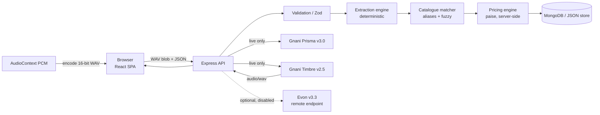

# ARCHITECTURE

## Diagram

## Frontend

- Vite SPA, React Router, no SSR. Layout with collapsible sidebar (persisted), mobile drawer, and command palette.
- `lib/api.ts` typed fetch wrapper (timeouts, CSRF echo, `ApiError`), `lib/audio.ts` recording + WAV encoding, `lib/format.ts` INR/paise/date helpers.
- Catalogue helpers in `lib/catalogue.ts`: `filterCatalogue` (name, category, description and Telugu/English aliases), `catalogueCategories`, `parseRupees`, `addCatalogueItem`/`removeCatalogueItem` (duplicates are ignored, never doubled).
- `components/ServicePicker.tsx` is the shared combobox/listbox used on New Job: arrow keys + Enter + Escape, click/tap to add, optional desktop drag-and-drop, explicit loading/error/empty/no-results states.
- `components/ui/voice-powered-orb.tsx` renders the New Job microphone visual with OGL/WebGL. It consumes normalized audio levels from the existing recorder; it does not open a second microphone stream.
- Brand and glass tokens are centralised in `client/src/index.css`: Ice Silver `#DDE3E8`, Deep Aubergine `#3A0F34`, Marigold `#EAAA00`, semantic surface/contrast/shadow/blur/motion tokens, and reusable glass classes. Backdrop blur is selective and wrapped in `@supports`; card/table text and form controls retain opaque or high-opacity surfaces. `lib/theme.test.ts` guards the approved brand palette.
- Interaction helpers: `lib/jobs.ts` (filter/sort/paginate), `lib/draft.ts` (sessionStorage draft with TTL), `lib/commands.ts` (palette entries), `lib/hooks.ts` (persisted state, debounce).
- Reusable UI in `components/ui.tsx`: buttons, fields with `aria-invalid` + `role="alert"`, `Skeleton`, focus-trapped `Modal`, `ConfirmDialog`.
- Server state fetched per page with small hooks; no global store, no TanStack Query (not needed at this size).
- Mock/Live badge from `/api/health` is shown only in Settings → Advanced / Developer diagnostics; the main chrome stays calm.
- Accessibility: global `:focus-visible` ring, `aria-sort` on sortable headers, combobox/listbox semantics in the palette, `prefers-reduced-motion` disables transitions and page animation.

## Backend

- Express app (`src/app.ts`) exported for tests; `src/index.ts` boots + seeds.
- Layered: routes → validators (Zod) → domain modules (`extraction`, `catalogue`, `pricing`, `telugu`) → data layer.
- Data layer interface `DataLayer` with two implementations: Mongoose (`db/mongo.ts`) and JSON file (`db/file.ts`, default when `MONGODB_URI` is empty).
- Request ID per request, structured `{ error: { code, message, details? }, requestId }` errors, 404 handler, no stack traces in production.

## Database

- Collections: `services`, `jobcards`, `counters`, `owners`, `garageprices`.
- `jobcards.jobId` unique index; `garageprices` has a unique `(garageId, serviceId)` index.
- File store writes `data/db.json` with a serialized write queue; loading an older file adds an empty `garagePrices` array in memory (migration-safe).

## Gnani integration

- `providers/gnani.ts`: Prisma multipart transcription (`audio_file`, `model`, `language_code`, `format`, optional `keyterms`, `topic`), Timbre JSON inference returning binary audio.
- Timeouts with `AbortSignal.timeout`, single attempt per user action, no retry loops, in-flight dedupe per operation type.
- Live requires `AI_PROVIDER_MODE=live` **and** a configured key; otherwise a clear 503/`mock` result.
- `providers/evon.ts` optional OpenAI-compatible chat completion, disabled unless `EVON_ENABLED=true` and `EVON_BASE_URL` set; output validated; never approves prices.

## Voice flow

1. Browser mic → AudioContext ScriptProcessor → Float32 chunks (max 30 s); per-frame RMS level also drives the recording orb and voice-detected hint.
2. `encodeWav` produces 16-bit PCM WAV (mono, 16 kHz target via `OfflineAudioContext`? no — native rate) — avoids WebM and ffmpeg entirely.
3. Uploaded files are decoded with `decodeAudioData` and re-encoded to WAV.
4. Server validates RIFF/WAVE header, size ≤ 5 MB, duration ≤ 30 s.

## Pricing & approval

- Service prices come only from the server catalogue. Frontend quantities are clamped 1..20; totals recomputed server-side.
- Central definitions live in `services`. A garage may override only the price: `garagePricing.applyGaragePrices` merges the garage's `garagePrices` record over a copy of the definition and returns `pricePaise` + read-only `defaultPricePaise`/`priceOverridden`. Preview, job creation and `GET /api/services` all use the merged list, so a garage price change affects future estimates only.
- Jobs keep the `unitPricePaise` snapshot written at approval; changing a garage price later never rewrites a saved job card.
- Preview is provisional (`approvalStatus: PENDING`); saving requires `mechanicApproved=true`, produces `APPROVED`, records `approvedAt` + status history.

## Backend

- Express app (`src/app.ts`) exported for tests; `src/index.ts` boots + seeds.
- Layered: routes → validators (Zod) → domain modules (`extraction`, `catalogue`, `pricing`, `telugu`) → data layer.
- Data layer interface `DataLayer` with two implementations: Mongoose (`db/mongo.ts`) and JSON file (`db/file.ts`, default when `MONGODB_URI` is empty).
- Request ID per request, structured `{ error: { code, message, details? }, requestId }` errors, 404 handler, no stack traces in production.

### Authentication (opt-in)

- `src/auth.ts`: Argon2id password hashing (OWASP baseline: 19 MiB, 2 iterations, 1 parallelism), one-time owner bootstrap via `GARAGE_SETUP_TOKEN`, session-user helpers.
- `src/authRoutes.ts`: `POST /api/auth/setup`, `POST /api/auth/login`, `POST /api/auth/logout`, `GET /api/auth/me`.
- `src/middleware.ts`: `requireAuth`, `requireOwner`, double-submit CSRF (`X-CSRF-Token`), stricter audio rate limit.
- Opt-in via `AUTH_ENABLED=true` + `AUTH_SESSION_SECRET`. When disabled (default), all existing frontend behavior is unchanged.
- Protected write routes (when enabled): `PATCH /api/services/:id/price`, `POST /api/demo/reset`, `PATCH /api/jobs/:id/status`, `PATCH /api/jobs/bulk-status`, `POST /api/ai/smoke-test`. Require an owner session + CSRF token. Catalogue definition writes do not exist.

## Security / privacy

- Key only on server; `.env` gitignored; health exposes booleans only.
- Audio is processed in memory and never persisted.
- CORS allow-list (explicit origins, no wildcard with credentials), rate limits on write + AI routes, upload MIME + magic byte checks, Zod validation, demo reset gated by `DEMO_MODE`.
- Helmet security headers: CSP (`defaultSrc 'self'`, `frameAncestors 'none'`, restricted `connectSrc`), `X-Content-Type-Options: nosniff`, referrer policy. HSTS intentionally omitted until HTTPS is confirmed on the deployment.
- Session cookies: `HttpOnly`, `SameSite=Lax`, `Secure` in production, 8-hour max age, rotating session ID on login.

## Deployment

- Frontend: Vercel static build with `VITE_API_URL`.
- Backend: Node host (Render/Railway/Fly free tier), root `.env` variables.
- DB: MongoDB Atlas free tier (or file store for a demo instance; note ephemeral disk).
